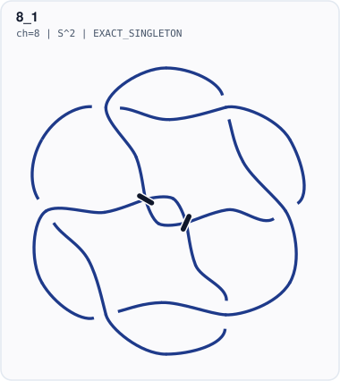
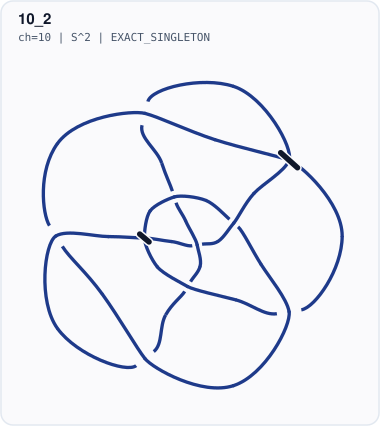
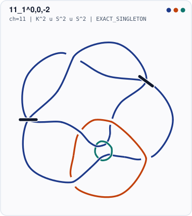
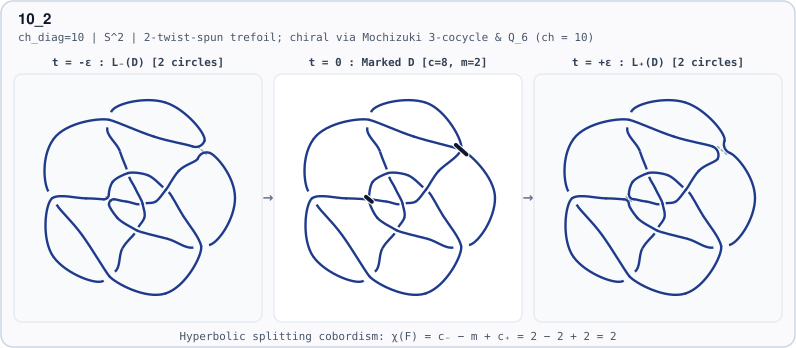

# Knotted Surfaces in $\mathbb{R}^4$ — An Atlas & Computational Census

A mathematical and computational research repository constructing a machine-verified atlas of **knotted surfaces and surface-links in $\mathbb{R}^4$**—orientable and non-orientable, connected and multi-component, up to $\mathrm{O}(4)$ equivalence—uniting exhaustive planar `ch`-diagram and bridge-trisection censuses with constructive parametric families, a 10-layer 4D topological invariant engine, and automated vector rendering.

|  |  |  |
| :---: | :---: | :---: |
| **`8_1` — Artin Spun Trefoil** ($S^2$, $\operatorname{ch}=8$)<br>$\pi_1$-ribbon · $c_{\text{tri}}=4$ · amphicheiral | **`10_2` — 2-Twist-Spun Trefoil** ($S^2$, $\operatorname{ch}=10$)<br>non-ribbon · $c_{\text{tri}}=6$ · 4D chiral ($\Phi_{\theta_3}$) | **`11_1^{0,0,-2}` — Klein–Sphere–Sphere Link** ($K^2 \sqcup S^2 \sqcup S^2$, $\operatorname{ch}=11$)<br>3-component non-orientable · $e = (0, 0, 0)$ |


*Pixel-registered hyperbolic splitting movie $L_-(D) \to D \to L_+(D)$ for the chiral 2-twist-spun trefoil `10_2`, certifying classical unlinks at $t = \pm \varepsilon$ and $\chi(S^2) = c_- - m + c_+ = 2 - 2 + 2 = 2$.*

---

## Highlights & Current Census Scope

- **Yoshikawa's Table ($\operatorname{ch} \le 10$) — Complete Machine Verification & Errata Proofs**:
  - Exhaustive verification of all **23** weakly prime surface-links with $\operatorname{ch}(F) \le 10$, every one certified `EXACT_SINGLETON` with zero invariant collisions across our 10-layer filtration ([`math/yoshikawa_table.md`](./math/yoshikawa_table.md), [`code/data/yoshikawa_ch10.json`](./code/data/yoshikawa_ch10.json)).
  - Self-contained zero-divisor Fox calculus proofs over $\mathbb{Z}[H_1]$ resolving all **3** classical Table II first-elementary-ideal errata (`9_1^{1,-2}`, `10_1^{0,1}`, `10_2^{0,-2}`).
- **Expanded $\operatorname{ch} = 11$ Census & Targeted $\operatorname{ch} = 12$ Enumerations**:
  - Exact prime 4-regular spherical shadow generation (`OEIS A113201`: `3,378` shadows at $\operatorname{ch}=11$; `15,882` at $\operatorname{ch}=12$) paired with a C99 two-stage Fast Kauffman Bracket Butterfly kernel, constructive Reidemeister $\mathrm{R1}/\mathrm{R2}/\mathrm{R3}$ unlink certification, and multi-pass $\Omega_1^+/\Omega_6^+/\Omega_2^+$ mountain-pass stabilization tunneling ([`math/ch11_expansion.md`](./math/ch11_expansion.md)).
  - **10** certified new weakly prime invariant classes at $\operatorname{ch} = 11$ (`11_1`, `11_2`, the first prime knotted $e=0$ Klein bottle `11_1^{-2}`, six 2-component links, and the 3-component link `11_1^{0,0,-2}`), plus **7** certified new $m=2$ prime $2$-knots at $\operatorname{ch} = 12$ promoting `R(b^2a)`, `R(b^2a^{-1})`, and `SymUnion(5_2, 1)` to exact $\operatorname{ch}(F) = 12$.
- **Hub-and-Spoke Parametric Families (`78` Distinct $\mathrm{O}(4)$ Classes Cataloged)**:
  - Constructive planar `ch`-diagram compilers for Artin spins $\tau^0(K)$, $m$-twisted symmetric-union 2-knots $U_m(K)$, general NORTH/SOUTH 1-fusion ribbon words $R(w)$, Satoh tubes $\operatorname{Tube}(L)$, mixed sphere–torus links, and non-orientable Klein-bottle links—cross-joined against the low-$\operatorname{ch}$ Hub with certified $[\operatorname{ch}_{\min}, \operatorname{ch}_{\max}]$ bounds ([`math/family_catalogs.md`](./math/family_catalogs.md)).
- **Complexity Measures & Exhaustive $(b \le 4, c_{\text{tri}} \le 6)$ Braided Tri-Plane Census**:
  - Exact intrinsic unknot floors $\operatorname{ch}_0(F)$ and excess complexity $\widetilde{\operatorname{ch}}(F) = \operatorname{ch}(F) - \operatorname{ch}_0(F)$, strict connected-sum subadditivity on non-orientable surfaces ($\operatorname{ch}(P_+ \# P_-) = 3 < 4$), and Viro $\#\,\mathbb{RP}^2$ collapse $\tau^{k+2}(K) \# P_\pm \cong \tau^k(K) \# P_\pm$ ([`math/complexity_measures.md`](./math/complexity_measures.md)).
  - Exhaustive C99 scan of **36,166,398** certified valid braided $b = 4$ tri-plane triples up to $c_{\text{tri}} \le 6$, confirming Gong–Lewis-Monkman–Osnes (2026) Conjectures 3.6 & 3.7 on the braided $b \le 4$ locus and uncovering the **Meander Interleaving Obstruction** forcing `10_2` from $c_{\text{tri}} = 6$ up to $\operatorname{ch} = 10$.
- **10-Layer 4D Invariant Engine**:
  - Topology $(\chi, \text{orientability}, e(F_i))$, Wirtinger $\pi_1(S^4 \setminus F)$ & finite-group hom counts ($S_3, A_4, S_4, A_5, Q_8, \operatorname{Dic}_{16}$), multivariable integral Fox ideals $E_k \subset \mathbb{Z}[H_1]$ (including $\mathbb{Z}_2$-torsion rings), twisted $S_3$ Alexander ranks, kei / Alexander quandle / biquandle colorings, Mochizuki dihedral & Kamada–Oshiro octahedral symmetric quandle 3-cocycle state sums, peripheral $\operatorname{SL}(2, \mathbb{F}_3)$ longitudinal holonomy, Carter–Saito–Satoh triple-linking $t_{ijk}$, Sanderson double-linking $\operatorname{Dlk} \in \mathbb{Z}_2$, Lomonaco $\pi_2$ / finite-cover Betti profiles, and double branched covers $\Sigma_2(S^4, F)$.

---

## Repository Map

- **[`math/`](./math/)** — Self-contained theory, proofs, census tables, and roadmap ([`math/README.md`](./math/README.md)):
  - [`literature_review.md`](./math/literature_review.md) · [`foundations_and_invariants.md`](./math/foundations_and_invariants.md) · [`yoshikawa_table.md`](./math/yoshikawa_table.md) · [`ch11_expansion.md`](./math/ch11_expansion.md) · [`family_catalogs.md`](./math/family_catalogs.md) · [`complexity_measures.md`](./math/complexity_measures.md) · [`roadmap.md`](./math/roadmap.md)
- **[`code/`](./code/)** — Python 3.11 + C99 `surfaceknots` package, test suite, and JSON/CSV datasets ([`code/README.md`](./code/README.md)):
  - Core & C99 kernels: [`diagrams.py`](./code/src/surfaceknots/diagrams.py), [`moves.py`](./code/src/surfaceknots/moves.py), [`unlink.py`](./code/src/surfaceknots/unlink.py), [`_fast_enum.c`](./code/src/surfaceknots/_fast_enum.c), [`fast_enum.py`](./code/src/surfaceknots/fast_enum.py)
  - Families, complexity & tri-planes: [`families.py`](./code/src/surfaceknots/families.py), [`complexity.py`](./code/src/surfaceknots/complexity.py), [`triplane.py`](./code/src/surfaceknots/triplane.py), [`triplane_census.py`](./code/src/surfaceknots/triplane_census.py)
  - 4D invariants: [`invariants/`](./code/src/surfaceknots/invariants/) (`fundamental_group.py`, `alexander.py`, `quandle.py`, `linking.py`, `tier3.py`)
  - Verified datasets: [`code/data/`](./code/data/) (`yoshikawa_ch10.*`, `expanded_ch11.*`, `families/*`, `complexity/*`)
- **[`pics/`](./pics/)** — Automated IRLS $p$-Laplacian Tutte SVG & standalone TikZ diagrams and hyperbolic splitting movies ([`pics/README.md`](./pics/README.md)).
- **[`expo/`](./expo/)** — Self-contained interactive KnotInfo-style Web Atlas ([`expo/surfaceknots_atlas.html`](./expo/surfaceknots_atlas.html)), including client-side diagram/movie rendering, pairwise 10-layer invariant separation, TikZ export, and a live custom EPD sandbox.
- **[`REFS.md`](./REFS.md)** — Annotated bibliography of censuses, move calculi, 4D invariants, bridge trisections, and open problems.
- **[`HANDOFF.md`](./HANDOFF.md)** — Engineering notes, C99 scaling guardrails, and prioritized compute playbook for multi-core high-performance enumeration.

---

## Quickstart

Requires Python $\ge 3.11$ and `gcc` (`_fast_enum.c` auto-compiles to `_fast_enum.so` via `gcc -O3 -march=native` on first import):

```bash
# Bootstrap virtual environment with uv and run the full 29-test verification suite
uv venv code/.venv
uv pip install --python code/.venv/bin/python -e "code[dev]"
PYTHONPATH=code/src code/.venv/bin/pytest -v
```

Inspect a surface-link and compute its full 10-layer invariant profile in Python:

```python
from surfaceknots import MarkedDiagram, YOSHIKAWA_BY_LABEL, compute_full_invariant_record

d = MarkedDiagram.from_epd(YOSHIKAWA_BY_LABEL["10_2"].canonical_epd)
rec = compute_full_invariant_record(d, label="10_2")
print(rec["e1_generators"], rec["mochizuki_c3_mod3"], rec["symmetry"]["summary"])
# ['3', 'x + 1'] ['3 + 6*u', '3 + 6*u^2'] chiral (no mirror symmetry certified)
```
