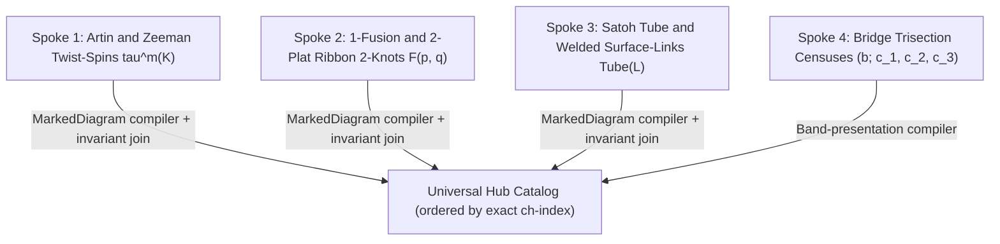

# Architecture & Research Roadmap

This document records the structural design decisions for scaling `surfaceknots` into a comprehensive, KnotInfo/LinkInfo-grade database of knotted surfaces and surface-links in $\mathbb{R}^4$.

---

## 1. Two-Tier Equivalence Schema: Move-Components, Invariant Cells, and Separating Witnesses

Unlike classical knots at low crossing number (where complete invariants and fast Reidemeister/SnapPy recognition collapse diagram equivalence and invariant equivalence simultaneously), tabulating 4-dimensional surface-links requires strictly separating **proven ambient isotopy** (move-equivalence) from **indistinguishability under computed invariants** (invariant-equivalence).

### 1.1 The Quotient Tower
At each complexity cutoff $\operatorname{ch}(D) = N$, every survivor diagram $D$ passes through the surjective tower (proved in [`foundations_and_invariants.md`](./foundations_and_invariants.md), Theorem 3.3):
$$\mathcal{D}_N^{\text{adm}} \;\twoheadrightarrow\; \mathcal{M}_N = \mathcal{D}_N^{\text{adm}} / {\sim_{\text{move}}^{(H)}} \;\twoheadrightarrow\; \mathcal{I}_{\le N}^{\text{true}} \;\twoheadrightarrow\; \mathcal{C}_N = \mathcal{D}_N^{\text{adm}} / {\sim_{\text{inv}}}.$$

Every invariant equivalence class $C \in \mathcal{C}_N$ in our JSON/CSV datasets carries an explicit **`cell_status`** tag determined by two integers — the number $m(C) \ge 1$ of Yoshikawa move-equivalence components inside $C$, and the set $\operatorname{Refs}_{<N}(C)$ of lower-complexity / composite / split / stabilized-unknotted reference classes matching $I(C)$:

| `cell_status` | Condition | Mathematical Guarantee |
| :--- | :--- | :--- |
| **`EXACT_SINGLETON`** | $\operatorname{Refs}_{<N}(C) = \emptyset$ and $m(C) = 1$ | **Unconditional**: $C$ represents **1** exact $\mathrm{O}(4)$-isotopy class $F$ with $\operatorname{ch}(F) = N$ (no move-height bound needed). |
| **`NEW_PACKET`** | $\operatorname{Refs}_{<N}(C) = \emptyset$ and $m(C) \ge 2$ | **Unconditional lower bound**: $C$ contains between $1$ and $m(C)$ genuinely new $\mathrm{O}(4)$-isotopy classes with $\operatorname{ch}(F) = N$; diagram sub-IDs (`11_1.a`, `11_1.b`, ...) track the $m(C)$ move-components until merged by deeper stabilization or split by a finer invariant. |
| **`AMBIGUOUS_SHADOW`** | $\operatorname{Refs}_{<N}(C) \neq \emptyset$ | **Potential duplicate / exotic candidate**: $I(C)$ collides with a known reference in $\operatorname{Refs}_{<N}(C)$ (most commonly a non-collapsible diagram of a lower-$\operatorname{ch}$ surface or stabilized unknot, or potentially an algebraic-doppelgänger new surface). Retained in the residual audit log rather than silently dropped or overclaimed. |

### 1.2 Explicit Separating Witnesses (`nearest_separating_witness`)
To answer *"why are $F$ and $F'$ definitely distinct?"* systematically across the entire catalog, we order our presentation-independent invariant hierarchy into $10$ layers (`invariant_filtration_layers` in [`yoshikawa_data.py`](../code/src/surfaceknots/yoshikawa_data.py)):
1. `topology` $(c,\; (g_i, \chi_i, \text{ori}_i, e_i)_{i=1}^c)$
2. `H1` (abelianization $\mathbb{Z}^r \oplus \mathbb{Z}_2^s$)
3. `E1` (multivariable Alexander elementary ideals over $\mathbb{Z}[H_1]$)
4. `Sigma2` (total mod-2 double branched cover $(\chi, b_1, \operatorname{Tors} H_1, b_2, |\sigma|)$)
5. `pi2_covers` (Poincaré–Lefschetz cover Betti profile $(b_1, \operatorname{Tors} H_1, b_2, b_3)$ on regular finite covers $\widetilde{E}_\rho$)
6. `finite_quotients` ($|\operatorname{Hom}(\pi_1, G)|$ + twisted $S_3$ Alexander factors)
7. `kei_bikei_abq` (kei, universal linear bikei over $\mathbb{Z}[s]/(s^2 - 1)$, and oriented Alexander biquandle modules)
8. `cocycles_and_sym_quandle` (Mochizuki $R_3$ 3-cocycles and Kamada–Oshiro $(Q_6, \rho)$ symmetric quandle colorings & 3-cocycles)
9. `double_triple_linking` (Sanderson mod-2 $\operatorname{Dlk}$ and Carter–Saito triple linking)
10. `peripheral_SL2F3` (non-meridional longitudinal $\operatorname{SL}(2, \mathbb{F}_3)$ holonomy)

For every entry $C$, `nearest_separating_witness` records its closest neighbor $C'$ in this lexicographic filtration together with the first invariant layer (and explicit values) where $I_k(C) \neq I_k(C')$.

---

## 2. Batch Geometric Identification Roadmap

Constructing exhaustive planar `ch`-diagrams bottom-up produces purely combinatorial EPD strings (`X/Y/Z` quadrangulations) before revealing their classical geometric names (such as *"spun $5_2$"*, *"1-fusion ribbon 2-knot of $8_9$"*, *"roll-spun trefoil"*, or *"welded Hopf-trefoil link"*).

Rather than hand-crafting ad hoc geometric identifications one diagram at a time, we adopt a **Batch Geometric Identification** workflow:
1. **Accumulate Census Strata First**: Expand exhaustive `ch`-censuses (`ch = 11`, `ch = 12` C/Rust distributed sweep, and $b \le 5$ tri-plane censuses) so all unlabeled `EXACT_SINGLETON` and `NEW_PACKET` cells are collected in uniform JSON catalogs with full Tier 1–3 invariant fingerprints.
2. **Batch Cross-Matching Pass**: Run automated compilers for standard geometric constructions (see §3 below) across classical knot/link tables up to 10–12 crossings, matching invariant keys in bulk and then certifying exact diagram equivalence via targeted mountain-pass Yoshikawa search where $\operatorname{ch}_{\text{constructed}}$ is close to $\operatorname{ch}_{\text{census}}$.
3. **Residual Geometric Mystery List**: Any census entry whose full invariant fingerprint fails to match *all* standard spun, twist-spun, ribbon-1-fusion, Satoh-tubed, and roll-spun families is highlighted as a **genuinely non-elementary 4D surface-link** warranting dedicated topological study (such as determining ribbonness of $10_2^{0,-2}$ and `11_1^0,-2`, or minimal triple-point numbers of `11_1^-2`).

---

## 3. Hub-and-Spoke Integration of Family-Specific Tables

In the literature, surface-link tables beyond $\operatorname{ch} \le 10$ are fragmented across **family-specific complexity measures** (ribbon 2-knots by fusion number and chord length, welded/ribbon tori by virtual crossing number, twist-spins by classical crossing number and twist index $m$, bridge trisections by $(b; c_1, c_2, c_3)$ and tri-plane crossing number $c_{\text{tri}}$).

To unify these without distorting the canonical $\operatorname{ch}$-ordering, `surfaceknots` uses a **Hub-and-Spoke Database Architecture**:

### Design Principles for Spoke Catalogs (`code/src/surfaceknots/families.py` & `code/data/families/`)
1. **Common Intermediate Representation (`MarkedDiagram`)**: Every family compiler outputs an explicit, admissible `MarkedDiagram` (`L_-` and `L_+` machine-verified to be unlinks) simplified by greedy $\operatorname{ch}$-reducing Yoshikawa moves.
2. **Certified Complexity Intervals `[ch_lower, ch_upper]`**:
   - The simplified compiled diagram immediately certifies a rigorous constructive upper bound $\operatorname{ch}(F) \le \operatorname{ch}(D_{\text{compiled}}) = \text{ch\_upper}$.
   - Cross-joining the invariant key $I(F)$ against the exhaustive Hub catalog up to $\operatorname{ch} \le N_{\max}$ (`N_max = 11` currently):
     - If $I(F)$ matches a unique `EXACT_SINGLETON` Hub entry at $\operatorname{ch} = k \le N_{\max}$ (or is move-verified equal), both bounds collapse to an **exact determination** $\operatorname{ch}(F) = k$ and automatically supply the Hub entry's geometric name!
     - If $I(F)$ does not appear anywhere in the exhaustive Hub catalog up to $N_{\max}$, Theorem 3.3 certifies the **rigorous lower bound** $\operatorname{ch}(F) \ge N_{\max} + 1$ (`ch_lower = 12`).
3. **Bidirectional Foreign Keys**: Hub records carry `family_realizations` (listing all Spoke parameterizations realizing that surface-link), while Spoke records carry `hub_match` (`"8_1"`, `"11_1"`, ..., or `null` when $\operatorname{ch}(F) \ge 12$).
