# `/pics` — Diagrammatic Gallery & Planar Rendering Specification

This directory houses automated vector illustrations (`.svg` in [`./svg/`](./svg) for web/Markdown viewing and standalone compilable `.tex` TikZ figures in [`./tikz/`](./tikz) for LaTeX manuscripts) of canonical marked graph diagrams (`ch`-diagrams) for knotted surfaces and surface-links in $\mathbb{R}^4$, generated by [`drawing.py`](../code/src/surfaceknots/drawing.py) (`python scripts/reproduce_datasets.py --gallery`).

---

## 1. Visual Conventions for Marked `ch`-Diagrams

Every surface-link $F \subset \mathbb{R}^4$ in hyperbolic splitting position is represented by a 4-regular planar shadow on $S^2$ decorated at each vertex (`MarkedDiagram` in [`diagrams.py`](../code/src/surfaceknots/diagrams.py), with CCW dart indices `0, 1, 2, 3`):

1. **Classical Crossings (`X0`, `X1`)**:
   - Drawn as two smooth transverse strands with a geometric under-strand gap (`(0, 2)` for `X0`, `(1, 3)` for `X1`) and a continuous stroke on the over-passing arc (`(1, 3)` for `X0`, `(0, 2)` for `X1`).
2. **Marked Saddle Vertices (`Y`, `Z`)**:
   - Drawn as a transverse 4-valent intersection carrying a **bold orthogonal marker bar** (Yoshikawa/Lomonaco convention) bisecting the two opposite quadrants smoothed together in $L_-(D)$:
     - For `Y`: $L_-(D)$ pairs `(0, 1)` and `(2, 3)`, while $L_+(D)$ pairs `(0, 3)` and `(1, 2)`; the marker bar spans the quadrant bisector separating `(0, 3),(1, 2)` and connecting the `(0, 1)` and `(2, 3)` lobes.
     - For `Z`: $L_-(D)$ pairs `(0, 3)` and `(1, 2)`, while $L_+(D)$ pairs `(0, 1)` and `(2, 3)`; the marker bar spans the dual bisector connecting the `(0, 3)` and `(1, 2)` lobes.
3. **Component Palette**:
   - Distinct connected components $F_1, \dots, F_c$ of $F(D)$ are rendered in high-contrast, colorblind-safe strokes (deep sapphire indigo `#1E3A8A`, vermilion `#C2410C`, viridian teal `#0F766E`, royal violet `#7E22CE`).

---

## 2. Automated Planar Layout Pipeline (`drawing.py`)

1. **Doubly-Subdivided Face-Star Triangulation (`G_aug`)**:
   - Extracts combinatorial faces directly from the CCW rotation system (`opp`), checks Euler planarity ($V - E + F = 2$), subdivides every edge twice so parallel multi-edges (`2_1^1`, `2_1^-1`) and kinks become simple cycles, and inserts radial face-star vertices inside bounded faces.
2. **IRLS $p$-Laplacian Tutte Harmonic Embedding + Polar Lobe Puffing**:
   - Solves $10$ iteratively reweighted $p$-Laplacian Tutte linear systems ($p \approx 3.35$) with strictly positive spring weights, guaranteeing convex interior faces and zero crossings while equalizing interior face areas, then puffs outer-face subdivision control points into $r > 1$ for rounded knot-table lobes.
3. **Convex-Corridor $C^1$ Cubic Bézier Splines & Dual Targets**:
   - Routes every half-edge inside its disjoint Tutte corridor with $C^1$-collinear tangents at edge midpoints and crossing centers, exporting both `./svg/<stem>.svg` and standalone compilable `./tikz/<stem>.tex`.

---

## 3. Yoshikawa's Canonical Prime Table ($\operatorname{ch}(F) \le 10$; 23 Entries)

| Diagram 1 | Diagram 2 | Diagram 3 |
| :---: | :---: | :---: |
| 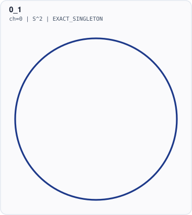 | 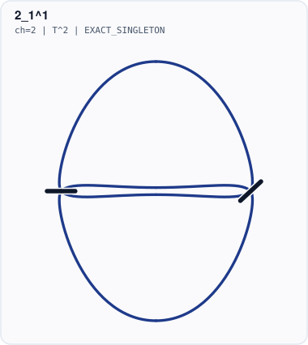 | 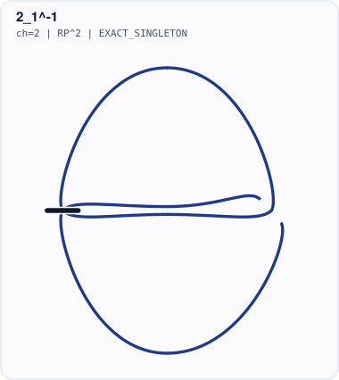 |
| **`0_1`** (`S^2`) [SVG](./svg/0_1.svg) · [TikZ](./tikz/0_1.tex) | **`2_1^1`** (`T^2`) [SVG](./svg/2_1_sup_1.svg) · [TikZ](./tikz/2_1_sup_1.tex) | **`2_1^-1`** (`RP^2`) [SVG](./svg/2_1_sup_m1.svg) · [TikZ](./tikz/2_1_sup_m1.tex) |
| 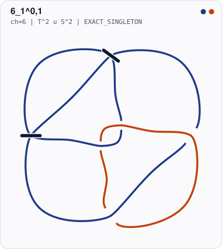 | 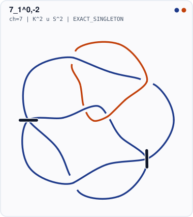 | 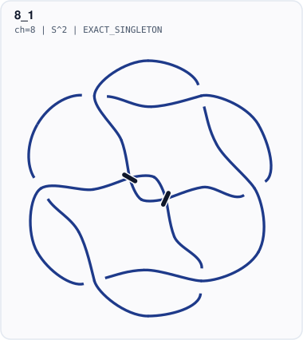 |
| **`6_1^0,1`** (`T^2 u S^2`) [SVG](./svg/6_1_sup_0_1.svg) · [TikZ](./tikz/6_1_sup_0_1.tex) | **`7_1^0,-2`** (`K^2 u S^2`) [SVG](./svg/7_1_sup_0_m2.svg) · [TikZ](./tikz/7_1_sup_0_m2.tex) | **`8_1`** (`S^2`) [SVG](./svg/8_1.svg) · [TikZ](./tikz/8_1.tex) |
| 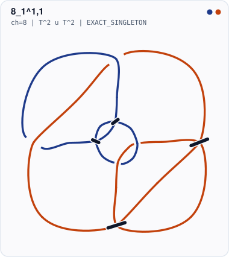 | 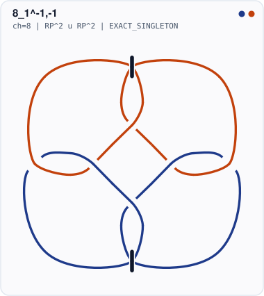 | 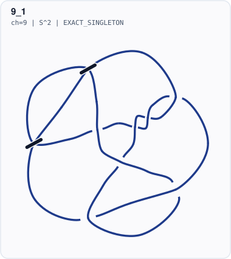 |
| **`8_1^1,1`** (`T^2 u T^2`) [SVG](./svg/8_1_sup_1_1.svg) · [TikZ](./tikz/8_1_sup_1_1.tex) | **`8_1^-1,-1`** (`RP^2 u RP^2`) [SVG](./svg/8_1_sup_m1_m1.svg) · [TikZ](./tikz/8_1_sup_m1_m1.tex) | **`9_1`** (`S^2`) [SVG](./svg/9_1.svg) · [TikZ](./tikz/9_1.tex) |
| 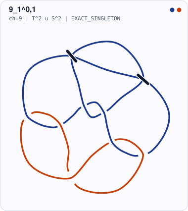 | 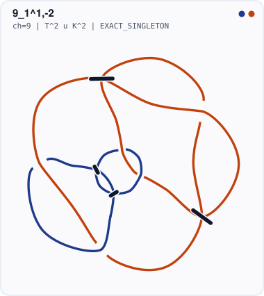 | 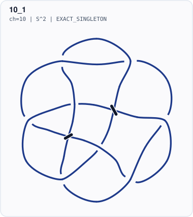 |
| **`9_1^0,1`** (`T^2 u S^2`) [SVG](./svg/9_1_sup_0_1.svg) · [TikZ](./tikz/9_1_sup_0_1.tex) | **`9_1^1,-2`** (`T^2 u K^2`) [SVG](./svg/9_1_sup_1_m2.svg) · [TikZ](./tikz/9_1_sup_1_m2.tex) | **`10_1`** (`S^2`) [SVG](./svg/10_1.svg) · [TikZ](./tikz/10_1.tex) |
| 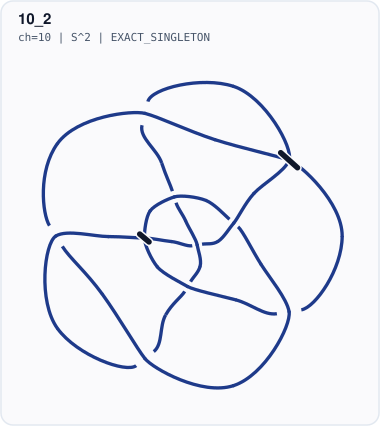 | 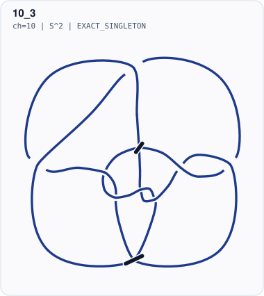 | 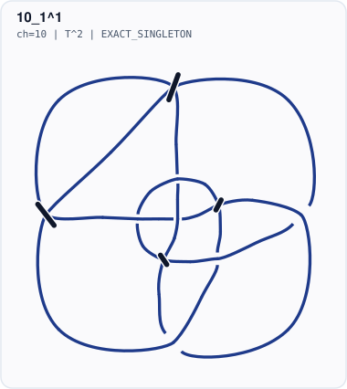 |
| **`10_2`** (`S^2`) [SVG](./svg/10_2.svg) · [TikZ](./tikz/10_2.tex) | **`10_3`** (`S^2`) [SVG](./svg/10_3.svg) · [TikZ](./tikz/10_3.tex) | **`10_1^1`** (`T^2`) [SVG](./svg/10_1_sup_1.svg) · [TikZ](./tikz/10_1_sup_1.tex) |
| 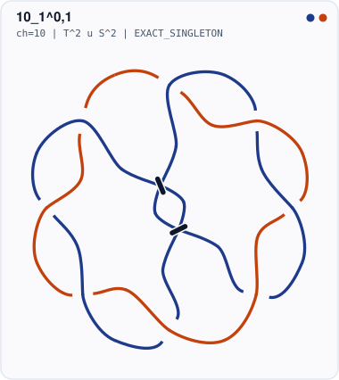 | 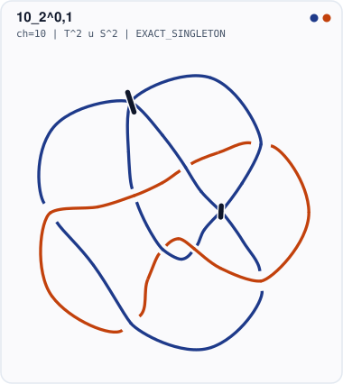 | 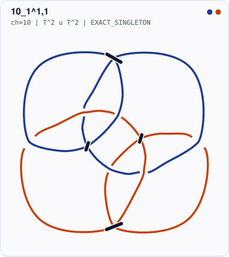 |
| **`10_1^0,1`** (`T^2 u S^2`) [SVG](./svg/10_1_sup_0_1.svg) · [TikZ](./tikz/10_1_sup_0_1.tex) | **`10_2^0,1`** (`T^2 u S^2`) [SVG](./svg/10_2_sup_0_1.svg) · [TikZ](./tikz/10_2_sup_0_1.tex) | **`10_1^1,1`** (`T^2 u T^2`) [SVG](./svg/10_1_sup_1_1.svg) · [TikZ](./tikz/10_1_sup_1_1.tex) |
| 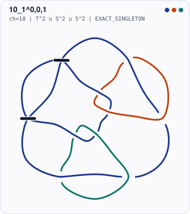 | 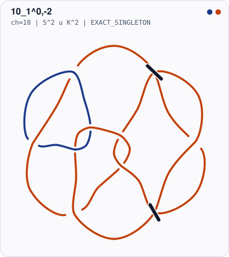 | 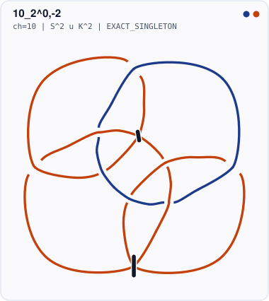 |
| **`10_1^0,0,1`** (`T^2 u S^2 u S^2`) [SVG](./svg/10_1_sup_0_0_1.svg) · [TikZ](./tikz/10_1_sup_0_0_1.tex) | **`10_1^0,-2`** (`S^2 u K^2`) [SVG](./svg/10_1_sup_0_m2.svg) · [TikZ](./tikz/10_1_sup_0_m2.tex) | **`10_2^0,-2`** (`S^2 u K^2`) [SVG](./svg/10_2_sup_0_m2.svg) · [TikZ](./tikz/10_2_sup_0_m2.tex) |
| 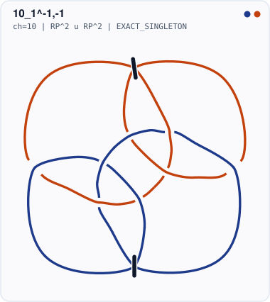 | 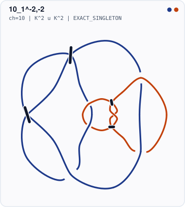 |  |
| **`10_1^-1,-1`** (`RP^2 u RP^2`) [SVG](./svg/10_1_sup_m1_m1.svg) · [TikZ](./tikz/10_1_sup_m1_m1.tex) | **`10_1^-2,-2`** (`K^2 u K^2`) [SVG](./svg/10_1_sup_m2_m2.svg) · [TikZ](./tikz/10_1_sup_m2_m2.tex) |  |

---

## 4. Expanded Certified Prime Table ($\operatorname{ch}(F) = 11$; 10 Entries)

| Diagram 1 | Diagram 2 | Diagram 3 |
| :---: | :---: | :---: |
| 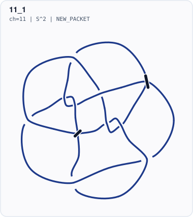 | 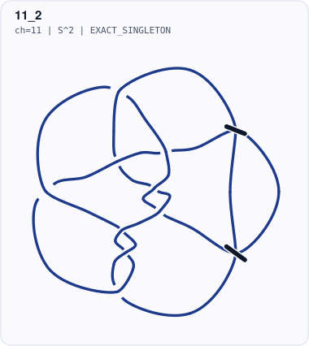 | 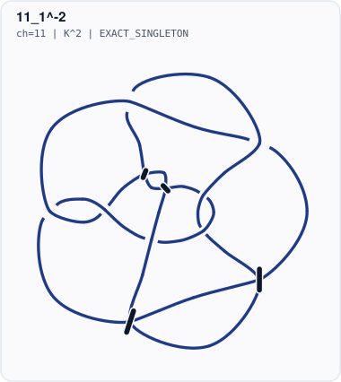 |
| **`11_1`** (`S^2`) [SVG](./svg/11_1.svg) · [TikZ](./tikz/11_1.tex) | **`11_2`** (`S^2`) [SVG](./svg/11_2.svg) · [TikZ](./tikz/11_2.tex) | **`11_1^-2`** (`K^2`) [SVG](./svg/11_1_sup_m2.svg) · [TikZ](./tikz/11_1_sup_m2.tex) |
| 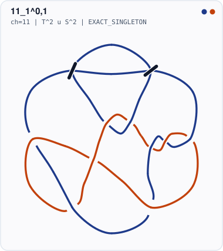 | 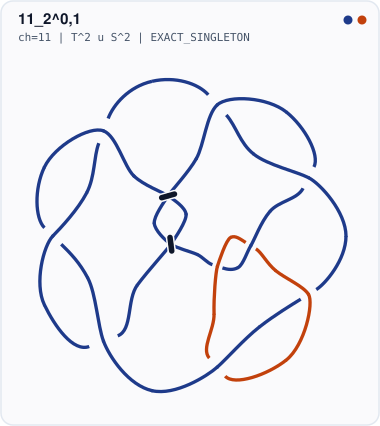 | 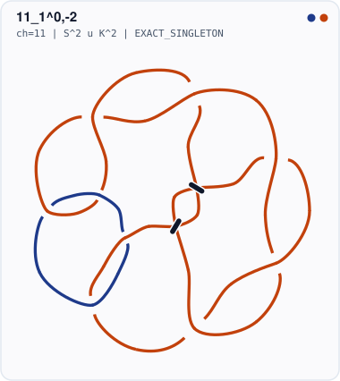 |
| **`11_1^0,1`** (`T^2 u S^2`) [SVG](./svg/11_1_sup_0_1.svg) · [TikZ](./tikz/11_1_sup_0_1.tex) | **`11_2^0,1`** (`T^2 u S^2`) [SVG](./svg/11_2_sup_0_1.svg) · [TikZ](./tikz/11_2_sup_0_1.tex) | **`11_1^0,-2`** (`S^2 u K^2`) [SVG](./svg/11_1_sup_0_m2.svg) · [TikZ](./tikz/11_1_sup_0_m2.tex) |
| 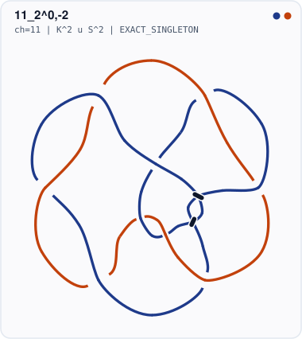 | 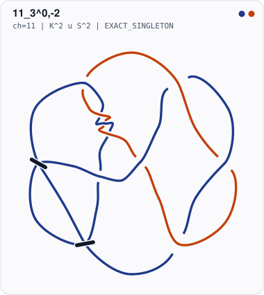 | 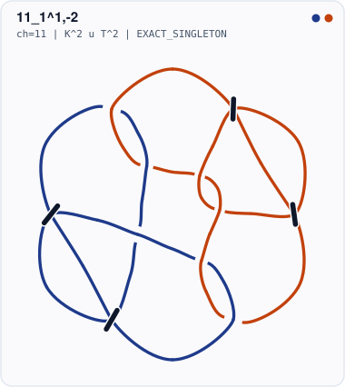 |
| **`11_2^0,-2`** (`K^2 u S^2`) [SVG](./svg/11_2_sup_0_m2.svg) · [TikZ](./tikz/11_2_sup_0_m2.tex) | **`11_3^0,-2`** (`K^2 u S^2`) [SVG](./svg/11_3_sup_0_m2.svg) · [TikZ](./tikz/11_3_sup_0_m2.tex) | **`11_1^1,-2`** (`K^2 u T^2`) [SVG](./svg/11_1_sup_1_m2.svg) · [TikZ](./tikz/11_1_sup_1_m2.tex) |
| 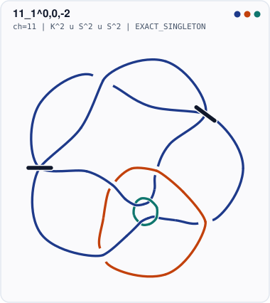 |  |  |
| **`11_1^0,0,-2`** (`K^2 u S^2 u S^2`) [SVG](./svg/11_1_sup_0_0_m2.svg) · [TikZ](./tikz/11_1_sup_0_0_m2.tex) |  |  |

---

## 5. Move-Component Packet Representatives (`11_1.a`, `11_1.b`, `11_1.c`)

| Diagram 1 | Diagram 2 | Diagram 3 |
| :---: | :---: | :---: |
| 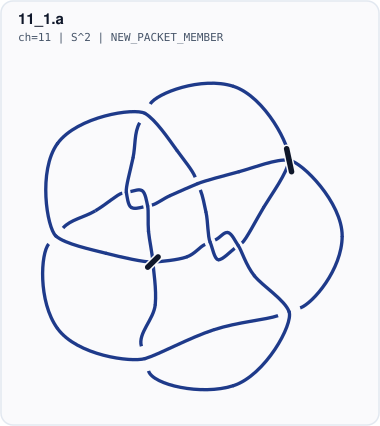 | 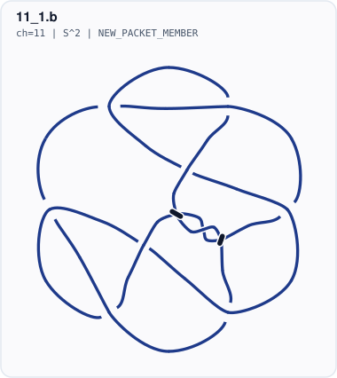 | 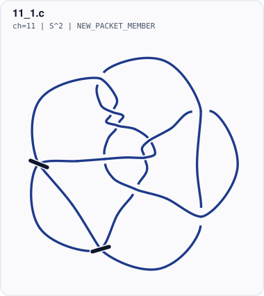 |
| **`11_1.a`** (`S^2`) [SVG](./svg/11_1_a.svg) · [TikZ](./tikz/11_1_a.tex) | **`11_1.b`** (`S^2`) [SVG](./svg/11_1_b.svg) · [TikZ](./tikz/11_1_b.tex) | **`11_1.c`** (`S^2`) [SVG](./svg/11_1_c.svg) · [TikZ](./tikz/11_1_c.tex) |

---

## 6. Hyperbolic Splitting Movie Triptychs ($L_-(D) \to D \to L_+(D)$)

Each triptych shares a single pixel-registered Tutte $p$-Laplacian layout across all three level slices ($t = -\varepsilon, 0, +\varepsilon$), displaying the classical resolution circles $c_-$ and $c_+$, faint dashed saddle attachment loci, and the topological Euler balance $\chi(F) = c_- - m + c_+$.

### `2_1^1` (`T^2`) — Unknotted torus T^2 (ch = 2)

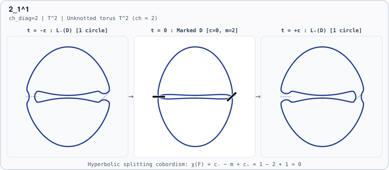

### `2_1^-1` (`RP^2`) — Standard projective plane RP^2 with e = +2 (ch = 2)

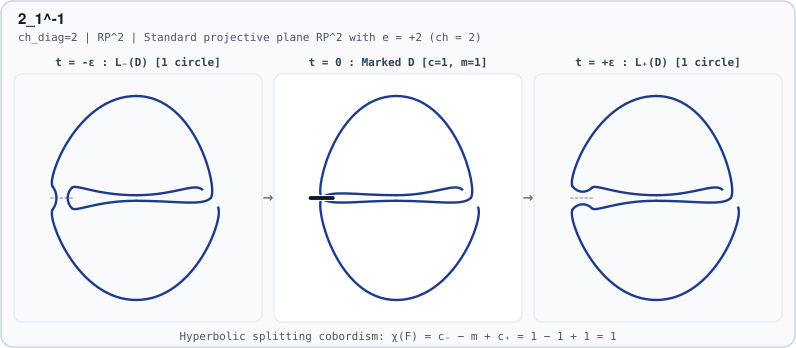

### `8_1` (`S^2`) — Artin spun trefoil 2-knot Spin(3_1) (ch = 8)

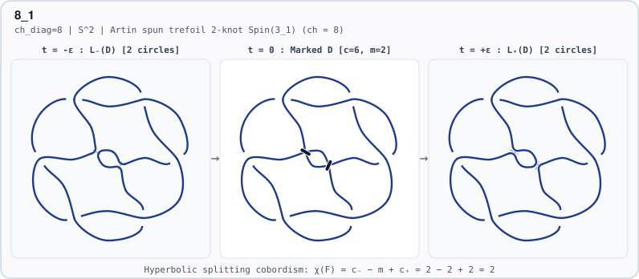

### `9_1` (`S^2`) — 1-fusion ribbon trefoil 2-knot (ch = 9)

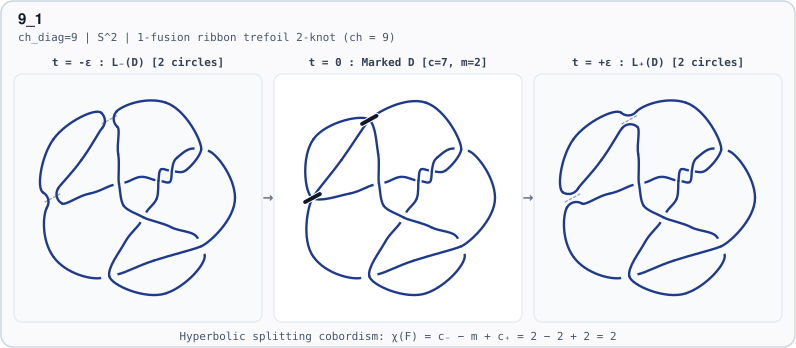

### `10_2` (`S^2`) — 2-twist-spun trefoil; chiral via Mochizuki 3-cocycle & Q_6 (ch = 10)

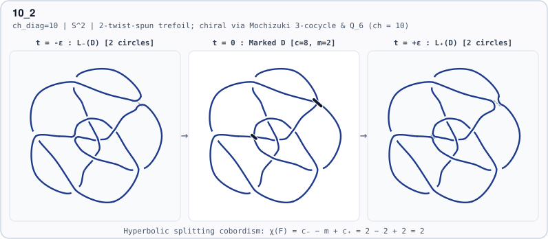

### `10_1^0,1` (`T^2 u S^2`) — Mixed sphere-torus link Mixed(L4a1) (ch = 10)

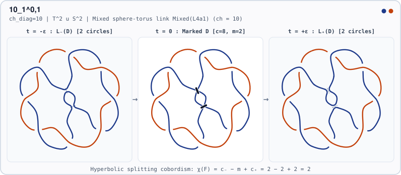

### `10_1^1,1` (`T^2 u T^2`) — Satoh tube of Hopf link Tube(L2a1) (ch = 10)

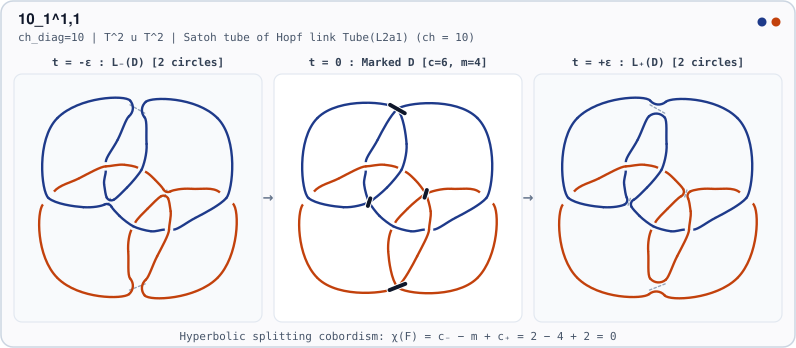

### `11_1` (`S^2`) — Symmetric-union figure-eight 2-knot SymUnion(4_1,1) (ch = 11)

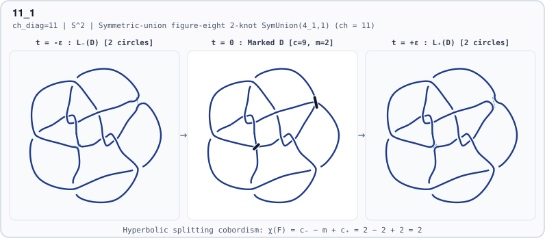

### `11_1^-2` (`K^2`) — First prime knotted Klein bottle K^2 with e = 0 (ch = 11)

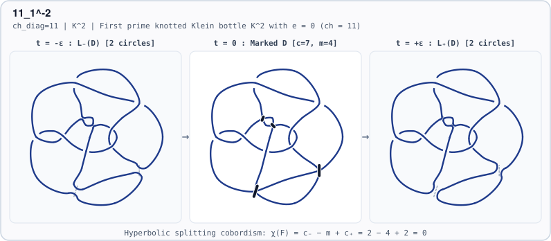

### `11_1^0,0,-2` (`K^2 u S^2 u S^2`) — Newly discovered 3-component Klein-sphere-sphere link (ch = 11)

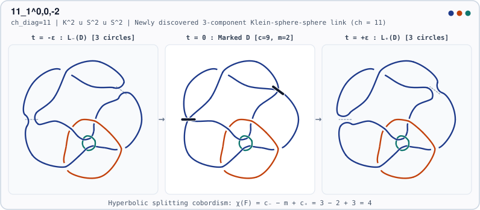

### `Tube(4_1)` (`T^2`) — Certified exact ch = 12 Satoh figure-eight torus

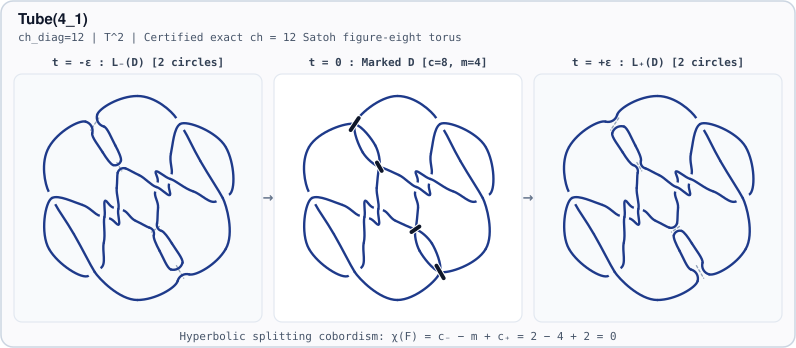

### `Mixed(L6a4,01)` (`T^2 u S^2 u T^2`) — Brunnian 3-component Borromean mixed link (ch <= 16)

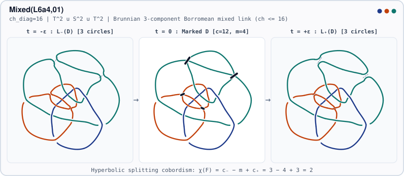

---

## 7. Certified Exact $\operatorname{ch}(F) = 12$ & Parametric Spoke Showcase

| Diagram 1 | Diagram 2 | Diagram 3 |
| :---: | :---: | :---: |
| 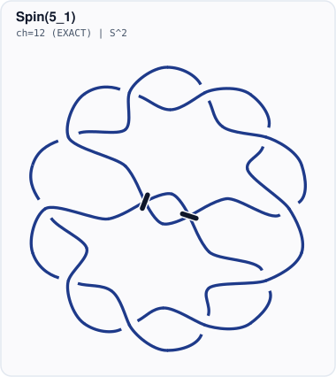 | 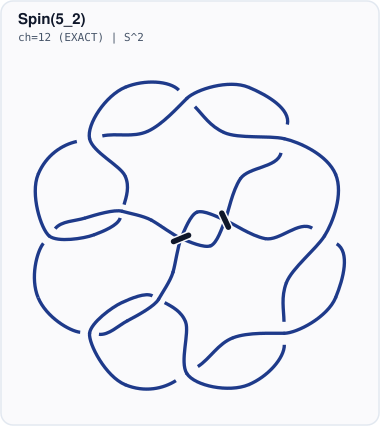 |  |
| **`Spin(5_1)`** (`S^2; ch=12 (EXACT)`) [SVG](./families/svg/Spin_5_1.svg) · [TikZ](./families/tikz/Spin_5_1.tex) | **`Spin(5_2)`** (`S^2; ch=12 (EXACT)`) [SVG](./families/svg/Spin_5_2.svg) · [TikZ](./families/tikz/Spin_5_2.tex) | **`Tube(4_1)`** (`T^2; ch=12 (EXACT)`) [SVG](./families/svg/Tube_4_1.svg) · [TikZ](./families/tikz/Tube_4_1.tex) |
|  |  |  |
| **`Tube(L4a1)`** (`T^2 u T^2; ch=12 (EXACT)`) [SVG](./families/svg/Tube_L4a1.svg) · [TikZ](./families/tikz/Tube_L4a1.tex) | **`Mixed(L5a1)`** (`S^2 u T^2; ch=12 (EXACT)`) [SVG](./families/svg/Mixed_L5a1.svg) · [TikZ](./families/tikz/Mixed_L5a1.tex) | **`Mixed(L6a4,01)`** (`T^2 u S^2 u T^2; ch in [12,16]`) [SVG](./families/svg/Mixed_L6a4_01.svg) · [TikZ](./families/tikz/Mixed_L6a4_01.tex) |
|  |  |  |
| **`Tube(L6a4)`** (`T^2 u T^2 u T^2; ch in [12,22]`) [SVG](./families/svg/Tube_L6a4.svg) · [TikZ](./families/tikz/Tube_L6a4.tex) | **`R(b^2*a)`** (`S^2; ch in [12,14]`) [SVG](./families/svg/R_bp2_a.svg) · [TikZ](./families/tikz/R_bp2_a.tex) | **`R(b^2*a^-1)`** (`S^2; ch in [12,14]`) [SVG](./families/svg/R_bp2_am1.svg) · [TikZ](./families/tikz/R_bp2_am1.tex) |
